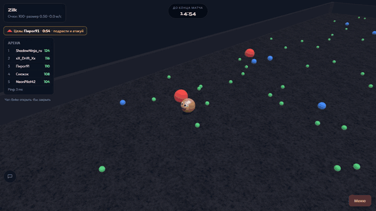
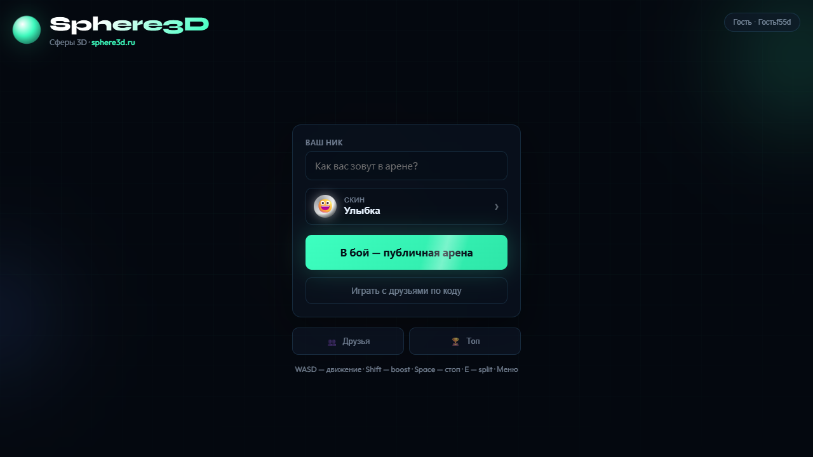
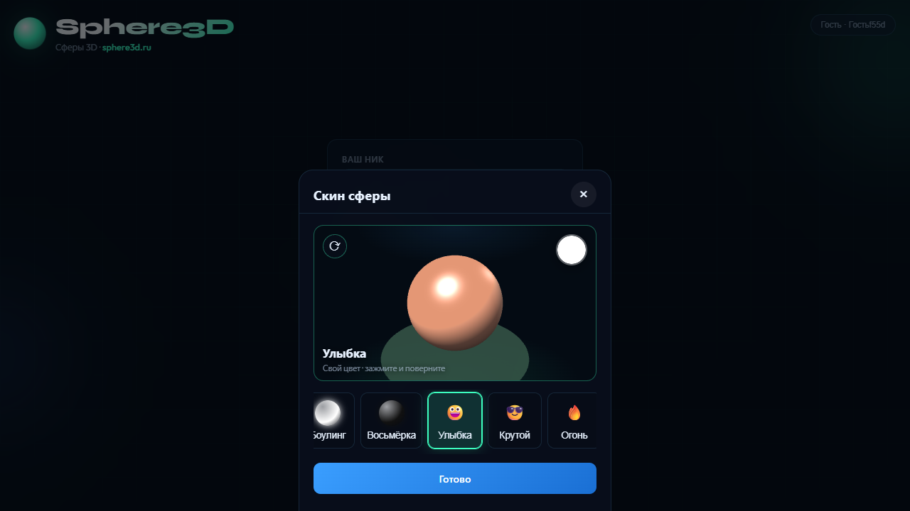
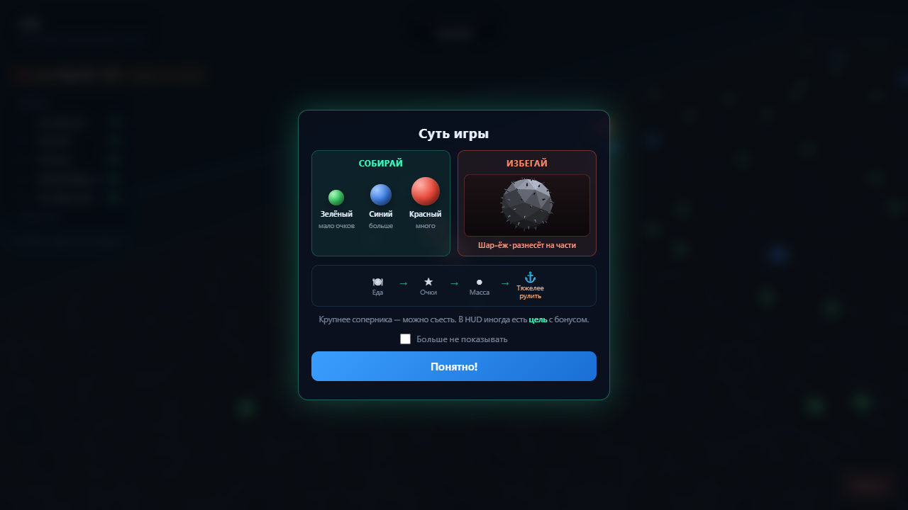
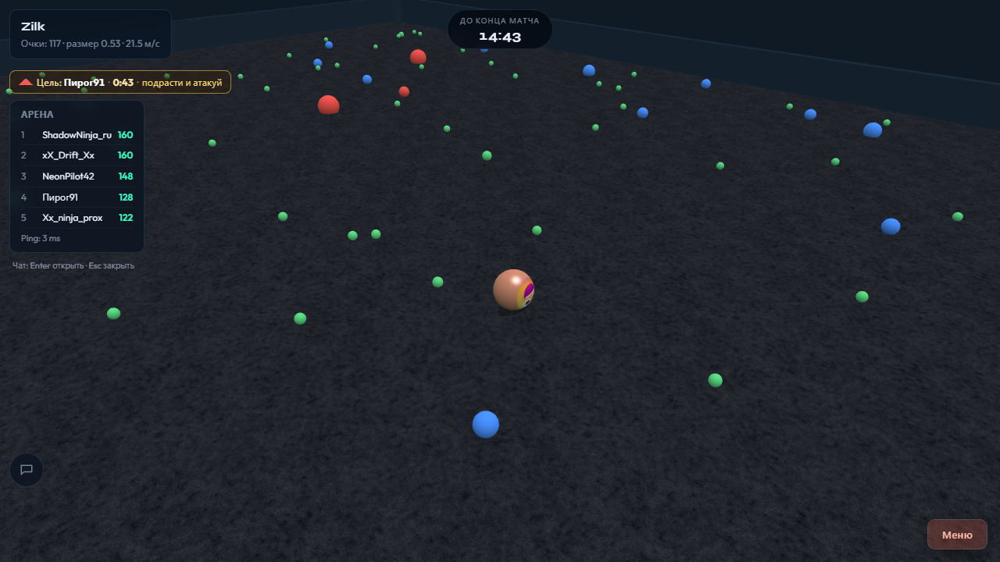
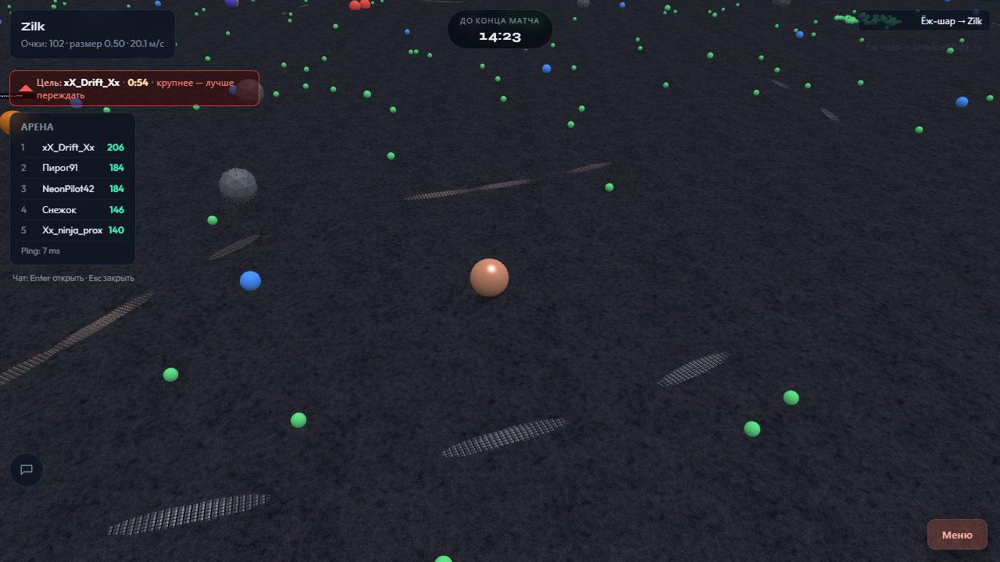
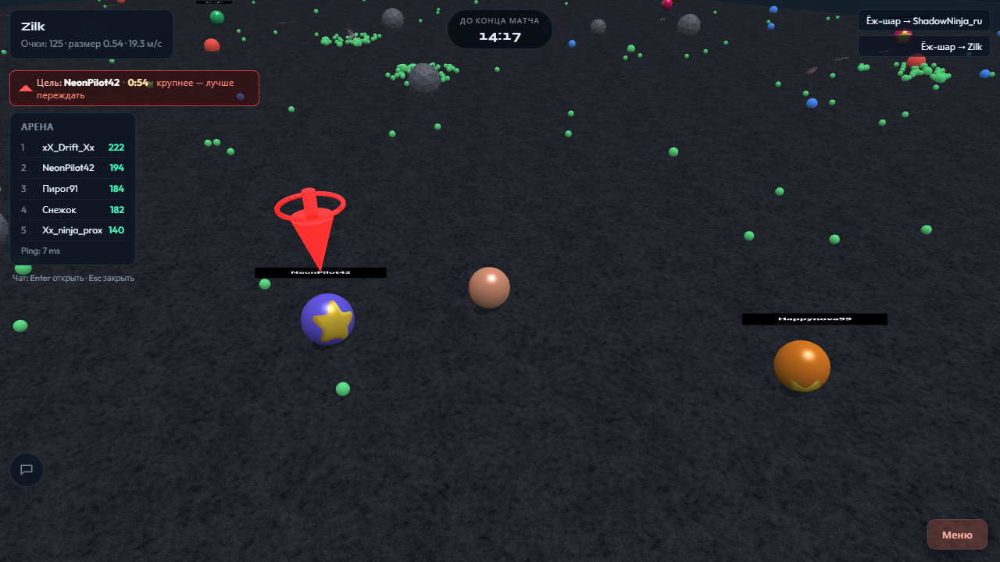

# Sphere3D

**English** · [Русский](README.ru.md)

**A real-time multiplayer 3D arena in the browser: roll a sphere, eat pellets, outgrow everyone else.**
Think agar.io, but with real rigid-body physics, a 3D camera and an authoritative server.

> **Portfolio project, built AI-first.** Almost all of the code was written by an AI coding agent under my direction.
> The live demo at sphere3d.ru has been taken offline (I stopped paying for hosting), so run it locally. It takes one command with Docker.
> An honest review of what is good and what is not lives in [docs/AUDIT.md](docs/AUDIT.md).



[Full-quality gameplay video (MP4, 4 MB)](docs/media/gameplay.mp4)

## Screenshots

| Menu | Skin picker (3D preview) |
|---|---|
|  |  |

| How to play | In match |
|---|---|
|  |  |

| Split, skid marks, hedgehog hazard | Pause menu |
|---|---|
|  |  |

## Features

- **Physics-driven gameplay.** Spheres roll on a Rapier 3D simulation running on the server at 30 Hz.
- **Authoritative server with client-side prediction.** Inputs are validated and rate-limited on the server, speed is clamped, and the client predicts locally and reconciles with server patches.
- **Agar-style mechanics.** Eat pellets, eat smaller players, split into up to 4 parts (`E`), eject mass, boost at the cost of mass (`Shift`), brake (`Space`).
- **Hedgehog hazards** that punish careless rolling.
- **Bots** to keep arenas lively (up to 50 players per room, 15-minute matches).
- **Public arena and private lobbies** joined by a short code.
- **Accounts.** Guest play, or email and password with email verification (SMTP), JWT access and refresh tokens.
- **Meta layer.** 15 skins (emoji, patterned, glowing), a coin shop, leaderboard (daily and all-time), friends, in-match chat with a word filter, killfeed and a death screen.
- **Mobile-ready.** Virtual joystick and on-screen action buttons, PWA manifest.

## Tech stack

| Layer | Technology |
|---|---|
| Client | TypeScript, Vite, Babylon.js 7, colyseus.js |
| Realtime server | Node 22, Colyseus 0.15 (`@colyseus/schema`), Rapier 3D |
| API | Express, JWT, bcrypt, nodemailer |
| Data | PostgreSQL 16 (accounts, stats), Redis 7 (leaderboard, optional) |
| Shared code | npm workspace `shared/`: constants, kinematic step, message and API types, skin catalog |
| Infra | Docker Compose, nginx, Let's Encrypt, Python (paramiko) deploy scripts |

About 14k lines of TypeScript, CSS and SQL.

```
client/   Babylon.js renderer, input, HUD, menu UI, netcode (prediction, interpolation)
server/   Colyseus rooms, Rapier world, bots, anti-cheat, REST API, services
shared/   Code used by both sides, so client prediction matches the server
docs/     Architecture notes, audit, media
deploy/   Production compose file, nginx config, server setup
```

Architecture notes: [docs/ARCHITECTURE.md](docs/ARCHITECTURE.md). Roadmap: [ROADMAP.md](ROADMAP.md) (written in Russian).

## Run it locally

### Docker (everything: Postgres, Redis, server, client)

```bash
docker compose up --build -d
```

Open http://localhost:8080.

### Without Docker (guest mode, no database)

Accounts, shop and persistent stats need Postgres. Guest play works without it.

```bash
npm install
npm run build -w @spherio/shared
npm run dev:server      # http://localhost:2567
npm run dev:client      # http://localhost:5173 (proxies /api and /colyseus)
```

### Configuration

Copy `.env.example` to `.env`. Set a strong `JWT_SECRET` for anything public: the server refuses to start in production with a default one. Email verification needs the `SMTP_*` variables.

## Controls

| Input | Action |
|---|---|
| `WASD` / arrows | Move (relative to the screen) |
| `Space` | Brake |
| `E` | Split |
| `Shift` | Boost (spends mass) |
| `Enter` | Chat |
| Touch | Joystick and buttons |

## Known limitations

This is a pet project, not a product. Please read [docs/AUDIT.md](docs/AUDIT.md) before reusing anything: there are no automated tests, guest sessions live in server memory, and a few dependencies carry known advisories.

## License

[MIT](LICENSE)
